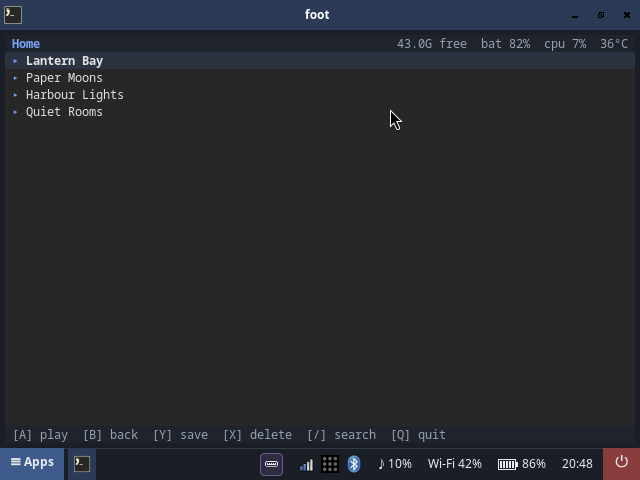
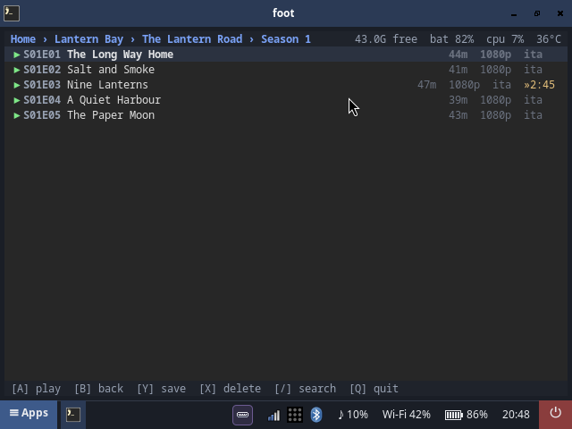
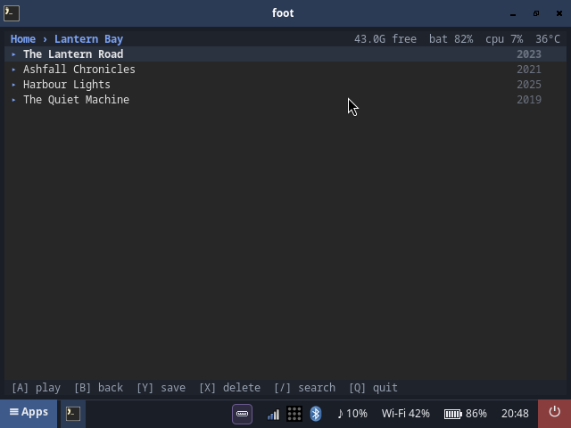
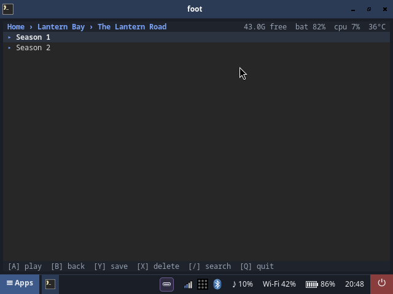

# Goblin — the Jellyfin client for the handheld

`goblin` is the one media app on the RG35XX H: a single, keypad-first
Jellyfin client in a terminal. It browses the library, plays what you pick
fullscreen, keeps your place, follows the subtitle preferences of your
Jellyfin account, and saves episodes to the SD card.

Start it with `Super+p` — it opens in a terminal window.



Every picture in this document is **mocked**: `tools/goblin-mock.py` drives the
real application (real widgets, real CSS, real layout) against a fake server
with invented library, series and episode names. These ones are photographs
of the actual RG35XX H running that mock — the terminal, the font, the
taskbar and all — so nothing copyrighted is in the repository and the
pictures cannot drift away from the UI. The same screens are also rendered
crisply as SVG (`img/goblin-*.svg`).

---

## The screen

Everything fits in one 80×24 terminal, and every row is one line:

```
 Home › Lantern Bay › The Lantern Road                43.0G free  bat 82%  cpu 7%  36°C
 ▸ Lantern Bay
 ▸ Paper Moons
   ▶ The Long Way Home                             44m  1080p  ita
 ▶ Salt and Smoke                                 41m  1080p  ita
 ▶ Nine Lanterns                                  47m  1080p  ita  »2:45
```

| part | what it shows |
|---|---|
| **top line, left** | the breadcrumb: where you are in the library |
| **top line, right** | free space on the card, battery, CPU load, temperature |
| **list** | one row per item: `▶` plays, `▸` opens a folder, `»27:31` is a resume point, `ita`/`eng` is the subtitle that will be used, `✓` is a saved copy |
| **bottom line** | the keys that do something right now |



| | |
|---|---|
|  |  |

Libraries are fetched 50 rows at a time and the next page arrives when the
cursor gets close to the end, so even a 533-item library paints in about a
second.

---

## Keys

### In the library

| key | action |
|---|---|
| `↑` `↓` | move the cursor |
| `A` / `Enter` | open a folder, or play the item under the cursor |
| `B` / `Esc` | go back (clears the search filter first, then leaves the folder) |
| `Y` / `Space` | **save** the item to the card (an episode, a season, a whole series) |
| `X` | **delete** the saved copy — press twice to confirm |
| `/` | search the current folder (server-side, so it finds items on page 40) |
| `Q` | quit |

### While a video plays

The mpv window has the focus, so the pad goes straight to it:

| key | action |
|---|---|
| `←` `→` | seek 15 s |
| `↑` `↓` | speed, ±0.25× per press (the hardware keys do the volume) |
| `A` / `Enter` | speed back to 1× |
| `Y` / `Space` | pause / resume |
| `X` / `Tab` | switch the subtitle track |
| `B` / `Esc` | close the video and drop back into the library |

### The handheld's own keys

In **keypad mode** (hold *Select* for a second) the gamepad becomes a
keyboard: the D-pad is the arrow keys, `A` is `Enter`, `B` is `Esc`, `X` is
`Tab`, `Y` is `Space`. That is the mode the client is designed for; a USB or
Bluetooth keyboard works just as well.

---

## What it does

**Browse.** Libraries → series → seasons → episodes, plus movies, music
videos and music. Music libraries are listed flat (one row per track), the way
a jukebox wants them.

**Search.** `/` searches the folder you are in, on the server, so a title
deep in a 533-item library is one keystroke away. `B` clears the filter
before it leaves the folder.

**Resume.** The client reads the stored position of every item and shows it
as `»27:31`; playing starts there. Coming back from a video (or from a
download) restores the folder, the pages that were loaded and the row under
the cursor.

Two things make it work: the client keeps its own book of what it watched
(`~/.local/state/goblin/positions.json`), because the server does not always
keep the position a client reports; and a resumed item is streamed from the
**original** file (bitrate capped) instead of the transcode — a transcode is
one growing file that cannot be seeked into, so the video would start at the
beginning no matter what position was asked for.

**Subtitles.** The language comes from **your Jellyfin profile**, not from the
client: *Settings → Playback → Subtitles* in the web UI sets the preferred
languages and the mode, and the client follows them (preferred language →
the media's own default track → the first track there is; mode `None` means
no subtitles). The row shows the language that will be used. A saved copy
keeps its subtitle as a sidecar next to the video, which mpv loads by itself.

**Save to the card.** `Y` saves the selected item under `~/Offline` — an
episode, a season, a whole series, a movie, a music video; whatever the
selection covers. The download runs **detached**: the list stays usable
while it works, the key line shows the progress, and the saved marks appear
when it is done. Pressing `Y` again while a download runs **queues** the
request instead of refusing it — the key line says how many jobs are ahead,
and they drain one after the other. Three files are saved at a time, which is 1.65× the
throughput on the handheld's Wi-Fi (a single stream is limited by the
connection, not by the server). Files that are already there are skipped;
`X` `X` removes them again — the server's copy is never touched. The free
space is on the top line, and a save that clearly will not fit is refused
before it starts.

**Subtitles come with it.** Every saved file gets its subtitle as a sidecar
next to it (`<name>.srt`), so a saved episode is fully offline — mpv loads
the sidecar by itself. The track is the one the profile would play: the
preferred language, else the media's default track, else the first text
track.

**Play.** The client asks Jellyfin to transcode to the panel
(`640×480`, the server keeps the aspect ratio, so 16:9 becomes 640×360) and
hands the result to mpv, which takes the whole screen. The position is
reported back to Jellyfin every ten seconds, so the web UI shows what the
handheld is playing.

**Intro skipping.** If the server knows where the intro of an episode is
(the media-segments API), the client jumps over it. On Jellyfin the data comes
from the [*Intro Skipper*](https://github.com/ConfusedPolarBear/intro-skipper)
plugin; without it there is nothing to skip.

**The status line.** Free space on the card, battery, CPU load and
temperature, refreshed every five seconds.

---

## Configuration

Everything lives in `/etc/default/goblin-dash` on the device (that file is
device state; the repository only ships the template).

```sh
DASH_JELLYFIN="http://192.168.1.60:8096"
DASH_API_KEY="<a user access token, see below>"
```

| variable | default | what it does |
|---|---|---|
| `DASH_JELLYFIN` | — | the Jellyfin server |
| `DASH_API_KEY` | — | a **user access token** (not an API key — see below) |
| `GOBLIN_MAX_WIDTH` | `640` | the width the server transcodes to; raise it for the HDMI monitor |
| `GOBLIN_MAX_HEIGHT` | `480` | the height the server transcodes to |
| `GOBLIN_VIDEO_BITRATE` | 4 bits/pixel/s | the video bitrate of the transcode (≈1.2 Mbit/s at 640×360) |
| `GOBLIN_AUDIO_BITRATE` | `96000` | the audio bitrate of the transcode |
| `GOBLIN_STREAM_TRANSCODE` | `1` | `0` streams the original file instead of a transcode |
| `GOBLIN_DL_TRANSCODE` | `1` | `0` saves the original file instead of a transcode |
| `GOBLIN_DL_TRANSCODE_MB` | `1024` | originals above this size are transcoded even if they fit the panel |
| `GOBLIN_SUB_LANGUAGES` | — | overrides the profile's subtitle languages, e.g. `ita,eng` |
| `GOBLIN_SKIP_INTRO` | `1` | `0` does not skip intros/recaps |
| `GOBLIN_DOWNLOAD_WORKERS` | `3` | how many files are saved at once |
| `GOBLIN_OFFLINE_DIR` | `~/Offline` | where the saved copies go (never `/tmp`: it is a 128 MB tmpfs) |

---

## The Jellyfin side

### Use a user token, not an API key

An API key creates an **anonymous** session on Jellyfin 12, and the server
refuses to store a playback position for it. A user access token creates a
real session: the server logs *"User admin started playback"*, keeps the
position, and the web UI shows the handheld's progress.

A user token can be minted **without the password**, with the server's
QuickConnect flow (three `curl` calls; the recipe is in
[desktop.md](desktop.md#a-user-token-for-the-client)).

### What the client follows from the profile

| profile field | effect |
|---|---|
| `SubtitleLanguagePreference` | the preferred subtitle languages, in order |
| `SubtitleMode` | `Default`, `Always`, `OnlyForced`, `Smart` or `None` |

### What the client writes back

- the playback position, every ten seconds and at the end
  (`/Sessions/Playing/Progress`), so "continue watching" works
- the played state, the same way the web client does

---

## The mpv side

`/etc/mpv/input-handtop.conf` holds the pad bindings during playback (it is
read *in addition* to mpv's own bindings).

The decode path is chosen per file: **zero-copy** (`--hwdec=drm`) when the
width is 64-pixel aligned — which the panel-sized transcode always is (640 =
10 × 64) — and the **copy path** (`--hwdec=drm-copy`) otherwise, because
panfrost cannot import a dmabuf with a stride it does not like, and the
video area would stay a flat blue rectangle. The client also checks the
width of the frame that is really playing and switches to the copy path if
the prediction was wrong. Measured on the device at 640×360: **16 % CPU**
with zero-copy against 28 % for the copy path, and 0 dropped frames.

---

## Files

| path | what |
|---|---|
| `/usr/local/bin/goblin` | the client (one Python file, no dependencies beyond Textual) |
| `/usr/local/share/applications/goblin.desktop` | the drawer entry |
| `/usr/local/share/rg35xxh/icons/app-goblin.png` | the icon (56 px pixel art, plus a `-light` variant) |
| `/etc/mpv/input-handtop.conf` | the pad bindings during playback |
| `/etc/default/goblin-dash` | the configuration (device state) |
| `~/Offline/` | the saved copies and their subtitles |

---

## Troubleshooting

**The video is blue.** That is the zero-copy import failing on a stride
panfrost does not accept. The client predicts the width and checks the real
one, so it should not happen; if it does, the video switches to the copy
path by itself within a second.

**No subtitles.** The client follows the profile: check *Settings → Playback
→ Subtitles* in the web UI, and check that the track is a text one (srt,
ass, vtt — image subtitles like PGS cannot be rendered as a sidecar).

**The list is empty.** The key line says `cannot reach …` when the server
cannot be reached.

**The resume point does not move.** The position is stored per user; an API
key cannot store one. Use a user token.

---

## Development

```sh
# the headless test (needs a Jellyfin server; no device needed)
JELLYFIN_URL=http://192.168.1.60:8096 JELLYFIN_KEY=… python3 tools/test-goblin-tui.py

# regenerate the mocked screenshots in this document
python3 tools/goblin-mock.py docs/img

# run the mock on the handheld itself (for photographing it)
scp tools/goblin-mock.py goblin:/tmp/ && ssh goblin 'foot -e "python3 /tmp/goblin-mock.py --live"'
ssh goblin 'grim /tmp/shot.png'   # and pull the picture back

# push the client to the handheld
tools/deploy.sh goblin
```
