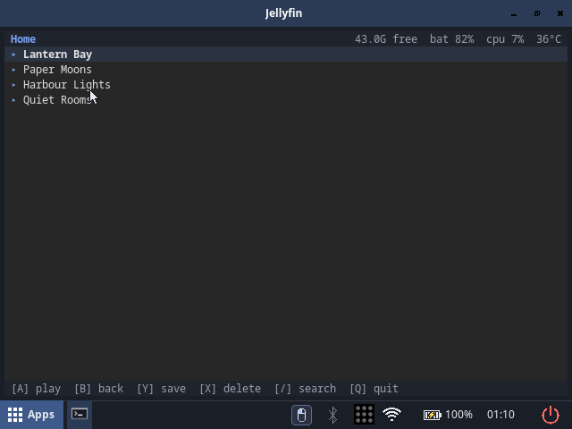
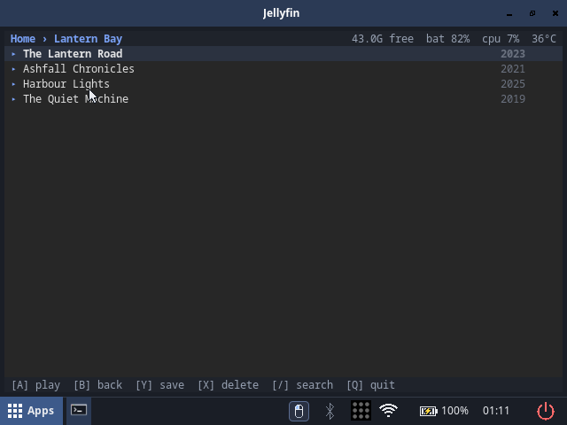
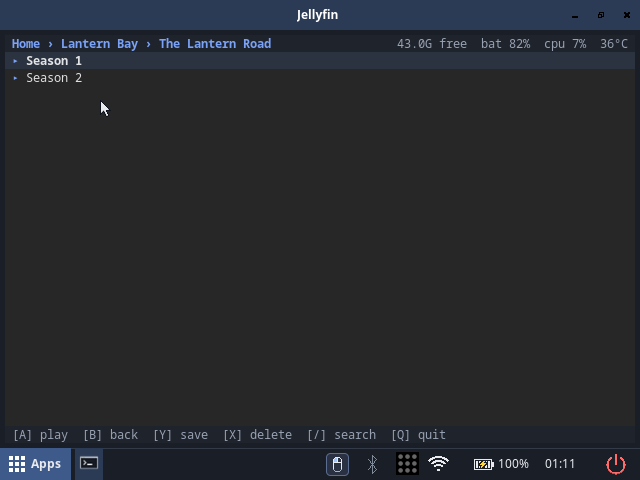
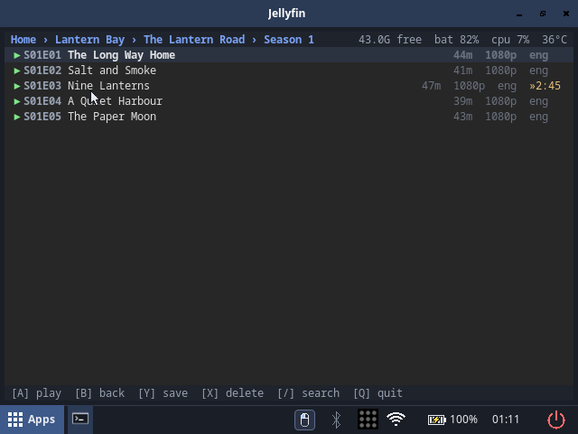

# Jellyfin — the media client for the handheld

Pick something from your Jellyfin server, it plays fullscreen, it remembers
where you were, and it can save episodes to the card. It runs in a terminal,
so it also works over SSH.



## Setup

Two values in `/etc/default/jellyfin`:

| variable | value |
|---|---|
| `JELLYFIN_URL` | your server, e.g. `http://mediaserver:8096` |
| `JELLYFIN_KEY` | a **user access token**, not an API key (see below) |

The server has to allow transcoding: the client asks for a transcode at the
panel's size (640×480), which the VPU decodes best and the Wi-Fi carries
easily.

### Getting a token

An API key makes an anonymous session, and Jellyfin then refuses to store a
playback position for it — "continue watching" stays empty. Worse, each
person should have their own session anyway. Mint a token once with the
user's password:

```sh
curl -s -X POST "$JELLYFIN_URL/Users/AuthenticateByName" \
  -H 'Content-Type: application/json' \
  -H 'Authorization: MediaBrowser Client="handtop", Device="handtop", DeviceId="handtop", Version="1"' \
  -d '{"Username":"<user>","Pw":"<password>"}' | jq -r .AccessToken
```

Put it in `JELLYFIN_KEY`. Revoke it later in the web UI (*Users → the user →
Active devices*).

### Starting it

Apps → **Jellyfin**, or `Super+p`. The first start reads the file above.

## Keys

In the library:

| key | does |
|---|---|
| `A` / Enter | play, or open the selected folder |
| `B` / Esc | back one level (clears a search first) |
| `Y` / Space | save the selected episode, season or series to the card |
| `X` / Tab | delete the saved copy (press twice) |
| `/` | search this folder |
| `Q` | quit |

While a video plays:

| key | does |
|---|---|
| `B` / Esc | close the video, back to the same row |
| `Y` / Space | pause |
| `X` / Tab | next subtitle track |
| D-pad ← → | seek 15 s |
| D-pad ↑ ↓ | speed, 0.25× per press |
| `A` / Enter | speed back to 1× |

On the handheld itself: hold **Select** (1 s) for keypad mode, hold it again
for desktop mode, **Start** for gamepad mode. Hard volume keys and the power
button work as always.

## The screen

| part | shows |
|---|---|
| top line, left | where you are in the library |
| top line, right | free space on the card, battery, CPU, temperature |
| rows | `▶` play, `▸` folder, `»27:31` a resume point, `✓` saved to the card |
| bottom line | the keys that do something right now |

| | |
|---|---|
|  |  |



Rows show the year for series, the length and resolution for episodes and
films, and the subtitle track that will be used. A series row opens its
seasons, a season opens its episodes.

## Subtitles

The languages and the mode come from your Jellyfin account, not from the
client: *Settings → Playback → Subtitles* in the web UI. The client follows
it — preferred language first, then the file's own default, then the first
track there is; mode `None` means no subtitles at all.

Saved copies keep their subtitle as a separate file next to the video, so
they play with subtitles offline too.

## Saving

`Y` on an episode, a season, a series, a film or a music video saves it to
`~/Offline`; a second `Y` on something saved toggles it off. Several files
save at once in the background, so the list stays usable. Saved items get a
`✓` and play from the card instantly.

## Settings

In `/etc/default/jellyfin`; the defaults are usually right.

| variable | default | what it does |
|---|---|---|
| `JELLYFIN_MAX_WIDTH` | `640` | size the server transcodes to (raise for an HDMI monitor) |
| `JELLYFIN_MAX_HEIGHT` | `480` | |
| `JELLYFIN_VIDEO_BITRATE` | ≈1.2 Mbit/s | |
| `JELLYFIN_SUB_LANGUAGES` | — | override the profile's subtitle languages |
| `JELLYFIN_DOWNLOAD_WORKERS` | `3` | files saved at once |
| `JELLYFIN_OFFLINE_DIR` | `~/Offline` | where saved copies go |
| `JELLYFIN_SKIP_INTRO` | `1` | `0` does not skip intros the server marks |
| `JELLYFIN_RESUME_MINIMUM` | `10` | positions shorter than this are ignored |

## If something is wrong

- **The list is empty, "cannot reach …"** — the server URL or the token is
  wrong, or the handheld is off the network.
- **No subtitles** — check the profile (above) and that the file has a text
  subtitle track (srt, ass, vtt; image subtitles cannot be used).
- **The resume point does not move** — an API key was used instead of a user
  token.
- **It refuses to play** — the server has transcoding disabled.
